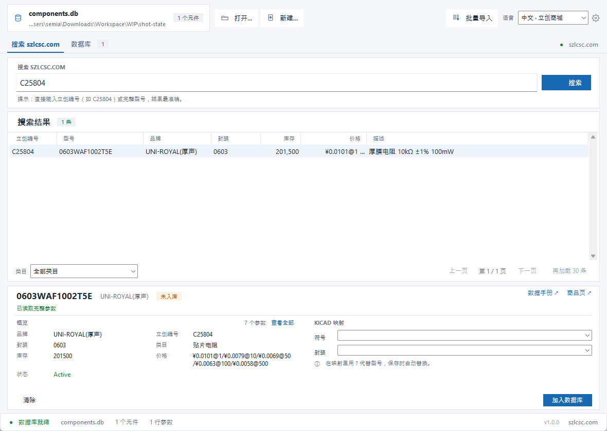
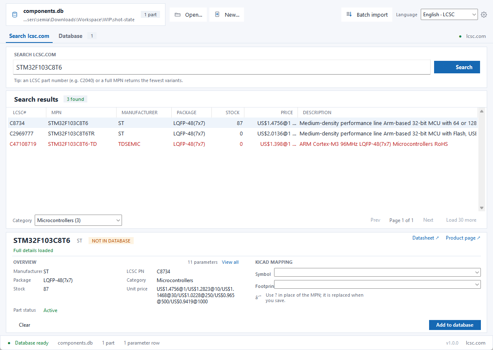
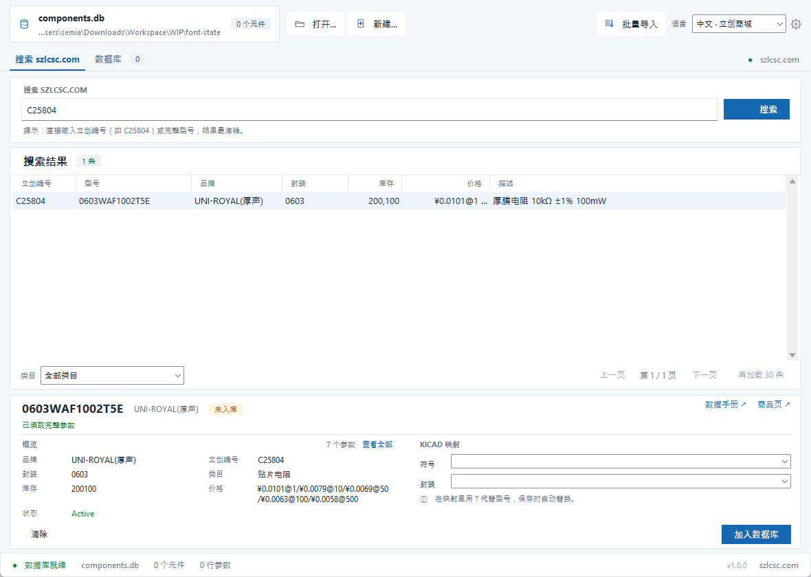
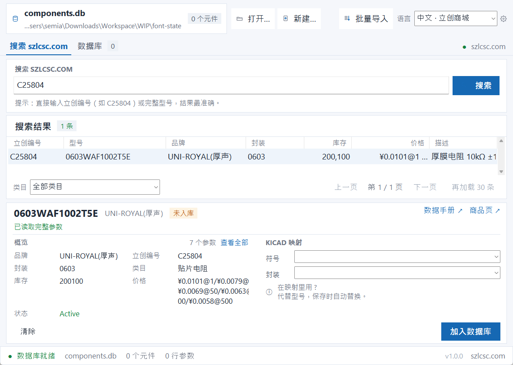
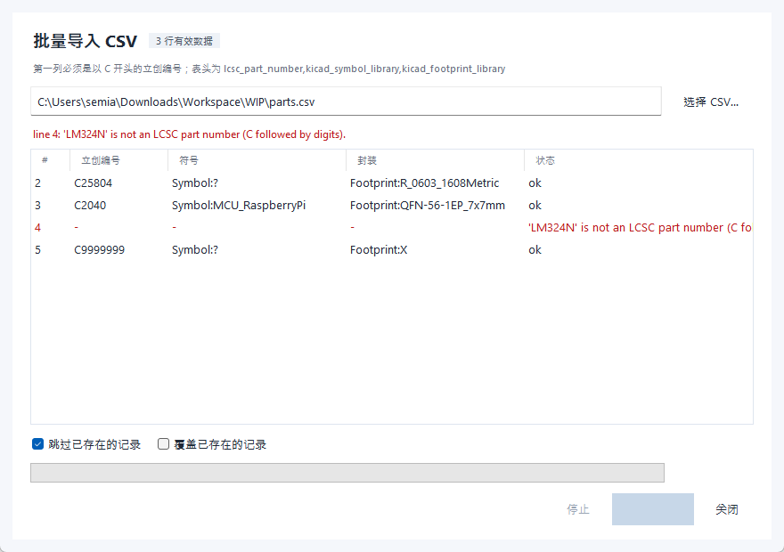
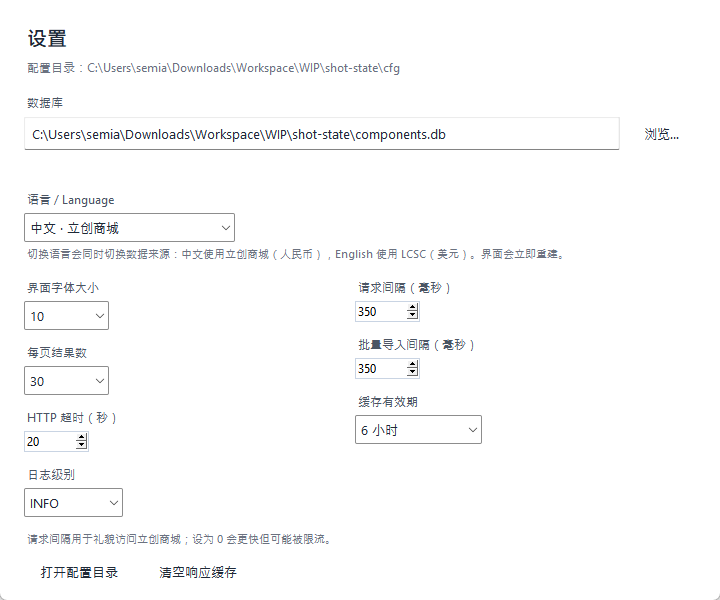

# KiCad LibGen LCSC

**Component Database Manager for LCSC** — a small native desktop front end that
searches **szlcsc.com** (Chinese) or **lcsc.com** (English) and writes the part
into the KiCad `components.db` schema.

It is the LCSC counterpart of [KiCad LibGen](../KicadLibGui/README.md), which
does the same against DigiKey. The database format is byte-for-byte identical,
so both tools — and KiCad's own database library — can share one file.



*Chinese UI, querying `szlcsc.com`: CNY ladder, Chinese parameter names, the
detail panel showing the enriched parameter set and the datasheet link.*



*English UI, querying `lcsc.com`: USD ladder, English parameter names, category
selector and paging.*

## What it does

- **Search either storefront**, chosen by the language setting:
  `中文 · 立创商城` queries `szlcsc.com` (¥, Chinese parameter names),
  `English · LCSC` queries `lcsc.com` (US$, English parameter names).
- **Browse results** with part number, MPN, brand, package, stock, headline price
  and description; page through 30 results at a time, narrow by category
  (`类目` / `Category`), or load the next page into the same table.
- **Scale the interface** from 8 to 20 pt in Settings — tables, dialogs and the
  detail panel re-flow in place, no restart.
- **See full details** for the selected part: every parameter the store reports,
  the datasheet link, the product page, and the complete price ladder.
- **Save into `components.db`** with an explicit upsert that updates an existing
  MPN instead of creating a duplicate row. The 80-column schema is unchanged, and
  `Symbol:?` / `Footprint:?` are expanded at save time.
- **Browse and edit** existing records, report duplicate MPNs, delete a record,
  and re-map its KiCad symbol/footprint.
- **Batch import** a CSV keyed by LCSC part number, with preview, validation,
  progress, cancellation and a log file.
- **Run standalone**: no Python, no installer, no local web server.

## Install-free usage

Build (or download) the artifact for your platform:

| Platform | Artifact | Run |
|---|---|---|
| Windows 10/11 x64 | `KiCadLibGenLCSC.exe` | Double-click. SmartScreen may warn because the binary is unsigned. |
| Linux x86_64 | `kicad-lib-gen-lcsc` | `chmod +x`, then run it. |

Build them yourself with `build\build_windows.ps1` or `build/build_linux.sh`;
both run the tests, the lint check and the packaged self-test and write a SHA256
file next to the artifact. PyInstaller cannot cross-compile, so build on each OS.

### First launch

1. Click **新建…** / **New…** and choose a local path such as
   `~/KiCadLibGenLCSC/components.db`. A `.db` file is an ordinary SQLite database.
2. Type an LCSC part number (`C25804`), an MPN, or keywords, and press **搜索** /
   **Search**.
3. Select a result, type the KiCad symbol and footprint library names (or leave
   `Symbol:?` / `Footprint:?`), and click **加入数据库** / **Add to database**.

### Where settings, logs and the cache live

| Item | Windows | Linux |
|---|---|---|
| Settings | `%APPDATA%\KiCadLibGenLCSC\settings.json` | `${XDG_CONFIG_HOME:-~/.config}/kicad-libgen-lcsc/settings.json` |
| Logs | `%LOCALAPPDATA%\KiCadLibGenLCSC\logs\app.log` | `${XDG_STATE_HOME:-~/.local/state}/kicad-libgen-lcsc/logs/app.log` |
| Response cache | `%LOCALAPPDATA%\KiCadLibGenLCSC\cache\` | `${XDG_STATE_HOME:-~/.local/state}/kicad-libgen-lcsc/cache/` |

**Portable mode:** pass `--portable` or create a file named `portable.txt` beside
the executable; settings, logs and cache then live in `data\` beside it.

**Do not keep a live database in OneDrive/Dropbox/Google Drive.** Sync clients can
lock or corrupt SQLite files; the app warns when the selected path is inside a
known sync folder and suggests a local folder.

## Language and storefront routing

The language setting decides both the interface language and the site that is
queried — the same rule as LCSC3D:

| Setting | Storefront | Currency | Parameters |
|---|---|---|---|
| `zh_CN` (default) | `szlcsc.com` | ¥ (CNY) | Chinese names (`阻值`, `精度`) |
| `en_US` | `lcsc.com` | US$ (USD) | English names (`Resistance`, `Tolerance`) |

Switching language rebuilds the interface in place and **clears the result table**,
because those rows came from the other storefront.

### Interface font size

Settings → **界面字体大小 / Interface font size** sets the body size (8–20 pt).
Every other size is derived from it and applied to named Tk fonts, so the change is
immediate: headings, tables (including row height and column widths) and dialogs
follow without restarting or losing the current selection.

| 10 pt (default) | 14 pt |
|---|---|
|  |  |

## KiCad database library

`db_setup/` holds a ready-made `.kicad_dbl` for each platform
(`components_db_windows.kicad_dbl`, `components_db_linux.kicad_dbl`). They map all
80 columns of the `components` table, so KiCad's symbol chooser can browse the
database the moment you register the file.

- Register it in *Preferences → Manage Symbol Libraries → Database → Add*. The
  library nickname becomes `components`, i.e. symbols are `components:<symbol>`.
- Both files expect the database at the program's suggested location
  (`%USERPROFILE%\KiCadLibGenLCSC\components.db` / `~/KiCadLibGenLCSC/components.db`);
  edit `source.connection_string` if yours lives elsewhere.
- You need an SQLite ODBC driver: [sqliteodbc](http://www.ch-werner.de/sqliteodbc/)
  on Windows (`SQLite3 ODBC Driver`), `libsqliteodbc` on Linux (`SQLite3`).
- The files are generated from the schema by `tools/gen_dbl.py`, and
  `tests/test_dbl_files.py` fails if their field list and the table ever diverge.

See [`db_setup/README.md`](db_setup/README.md) for the column-by-column mapping and
how to rename a field.

## What lands in the database

The schema is the same 80 columns KiCad LibGen creates, so an existing KiCad
database-library configuration keeps working. How LCSC data fills it:

| Column | Value |
|---|---|
| `ID` | `类目/型号` (`贴片电阻/0603WAF1002T5E`) |
| `Description` | the store's product name / intro |
| `Keywords` | the longer introduction or remark |
| `Value` | the value-type parameter when present (`10kΩ` → `10K`), else the MPN |
| `Manufacturer` | brand (`UNI-ROYAL(厚声)`) |
| `ManufacturerProductNumber` | MPN (`0603WAF1002T5E`) |
| `Package` | `0603`, `LQFP-48(7x7)` |
| `KicadSymbolLibrary`, `KicadFootprintLibrary` | what you typed (`?` → MPN) |
| `PartStatus` | `Active`, `Obsolete`, `Pre-order`, … |
| `QtyAvailable` | the stock the store shows |
| `Distributor` | `LCSC` or `LCSC International` |
| `DistributorProductNumber` | the LCSC part number (`C25804`) |
| `UnitPrice` | `¥0.0101@1/¥0.0079@10/…` (USD when in English) |
| `ProductUrl` | the item page |
| `DatasheetUrl` | the datasheet PDF the store links to |
| `Param01..32` / `Value01..32` | every parameter, headline specs first |

**Parameter slots:** LCSC reports more parameters than the 32 slots can hold, so
value-type and headline specifications (value, tolerance, power, voltage,
temperature, package) are floated to the front and the rest follow in the store's
own order. **查看全部 / View all** shows every parameter that was reported, not
just the ones that fitted.

**Prices and stock are snapshots** taken when you searched; the ladder is capped
at six tiers to keep the cell readable, and the full ladder is shown in the
detail panel.

## Batch import

The CSV is keyed by LCSC part number — one unambiguous lookup per row:

```csv
lcsc_part_number,kicad_symbol_library,kicad_footprint_library
C25804,Symbol:?,Footprint:R_0603_1608Metric
C2040,Symbol:MCU_RaspberryPi,Footprint:QFN-56-1EP_7x7mm
```

- UTF-8 (with or without BOM); the legacy header `manufacturer_product_number` is
  accepted, but every value must still be an LCSC part number (`C` + digits) —
  anything else is reported per row instead of being silently searched as an MPN.
- The preview lists every row with its line number and any problem, and the
  **Start** button stays disabled until the file is valid.
- Progress, cancellation, and a log written next to the CSV as
  `<name>-<yy-mm-dd-HH-MM-SS>.log` with one line per part:
  `<C-number>: <record> ==> <status>` (`inserted`, `updated`,
  `skipped-duplicate`, `skipped-no-result`, `skipped-ambiguous`, `error`,
  `cancelled`).



The preview lists every row with its line number; the invalid row is flagged in
place and **Start import** stays disabled until the file is valid.




## Command line

The GUI is the product, but there is a headless path for checking a part or a
protocol change:

```bash
python -m lcsc_core.cli C25804 --lang zh_CN            # print the 80-column row
python -m lcsc_core.cli "10k 0603" --lang en_US --limit 3 --json
python -m lcsc_core.cli C2040 --db components.db       # search, enrich and save
python tools/probe_endpoints.py --check                # verify the storefront protocol
```

## Development

Requirements: Python 3.12+, Tk 8.6 (bundled with CPython on Windows;
`python3-tk` on Linux), and `requests`.

```bash
python -m venv .venv
.venv\Scripts\activate            # Windows
# source .venv/bin/activate       # Linux
pip install -r requirements.txt
pip install pytest ruff pillow

python gui_main.py                # source run
python gui_main.py --self-test    # offline smoke check (no network)
python gui_main.py --smoke-test   # build the real window and close it
python gui_main.py --lang en_US   # start in English / against lcsc.com
pytest                            # test suite (offline, fixture driven)
ruff check .                      # lint
```

### Layout

```
kicad_core/      models, SQLite access (fixed upsert), schema validation, errors
lcsc_core/       storefront clients and everything else site-specific
  session.py       one polite HTTP client (pacing, retry, size caps, typed errors)
  domestic.py      szlcsc.com search + item page
  international.py lcsc.com discovery, list, product detail
  parsers.py       raw JSON -> the 80-column record
  routing.py       language -> storefront
  texts.py         bilingual interface strings
  cache.py         on-disk cache for detail responses
services/        config, search orchestration, database, batch, logging (no Tk)
gui/             app shell, theme (named fonts), worker, widgets, dialogs, database tab
tools/           probe_endpoints.py (protocol check), gen_dbl.py (KiCad mapping)
db_setup/        .kicad_dbl files for KiCad + how to use them
tests/           fixtures + parser, backend, cache, batch, database, dbl, GUI tests
build/           PyInstaller spec and platform build scripts
docs/            PROTOCOL.md (verified endpoints), DEV_PLAN.md, APPROVED-PLAN.md
```

### Build a one-file executable

```powershell
# Windows, from the repository root
.\build\build_windows.ps1
```

```bash
# Linux, from the repository root
./build/build_linux.sh
```

## Being a good citizen

The storefronts are ordinary public web sites, and this tool is deliberately
modest about it:

- one request at a time, with a minimum gap (`请求间隔`, 350 ms by default);
- one deliberate retry on 429/5xx, honouring `Retry-After`, never a retry storm;
- search results are always fetched fresh; only detail responses are cached, for
  six hours by default, and the cache can be cleared from Settings;
- no login, no cookies worth keeping, no account data, no personal data;
- `robots.txt` was checked for `lcsc.com`, `szlcsc.com`, `so.`, `item.` and
  `list.` on 2026-11-21; the paths used here are not disallowed.

**This is an unofficial tool.** It is not affiliated with LCSC or JLC, it uses the
public storefront pages rather than a documented API, and those pages can change
without notice. Prices and stock are snapshots, not quotes. Respect the store's
terms when using it.

## Known limitations

- **Undocumented interfaces**: the endpoints are the public web front end's own.
  They work as of the recorded date (see [`docs/PROTOCOL.md`](docs/PROTOCOL.md));
  `tools/probe_endpoints.py` re-verifies them and says what broke.
- **Chinese storefront needs two requests per part**: the full parameter table and
  the datasheet link come from the item page. Search rows already carry the
  datasheet, price, stock and the headline parameters, so the table is usable
  before the enrichment finishes.
- **English storefront is category-scoped**: a broad keyword returns the largest
  matching category first; use the category selector for the others, and note the
  store caps a result set at 5000 rows.
- **No headless mode without a display**; Tk needs X11/XWayland on Linux.
- **Windows SmartScreen**: the one-file executable is unsigned and may prompt.
- **One-file startup** extracts to `%TEMP%`; if policy blocks that, run from
  source or build with `--onedir`.

## Licence

MIT. The KiCad `components.db` layer, theme and GUI scaffolding are derived from
KiCad LibGen (MIT). The storefront protocol was re-implemented from a verified
description, not copied from another project — see
[`THIRD-PARTY-NOTICES.md`](THIRD-PARTY-NOTICES.md).
